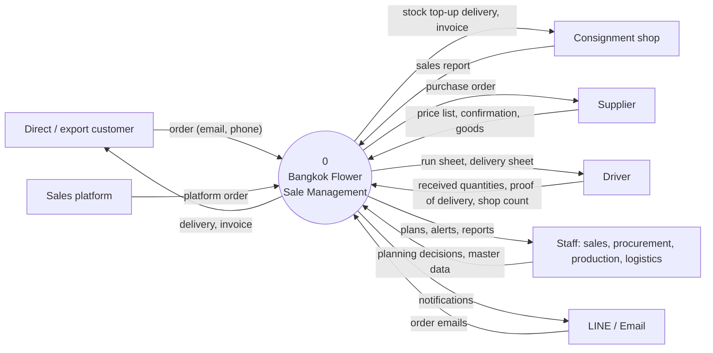
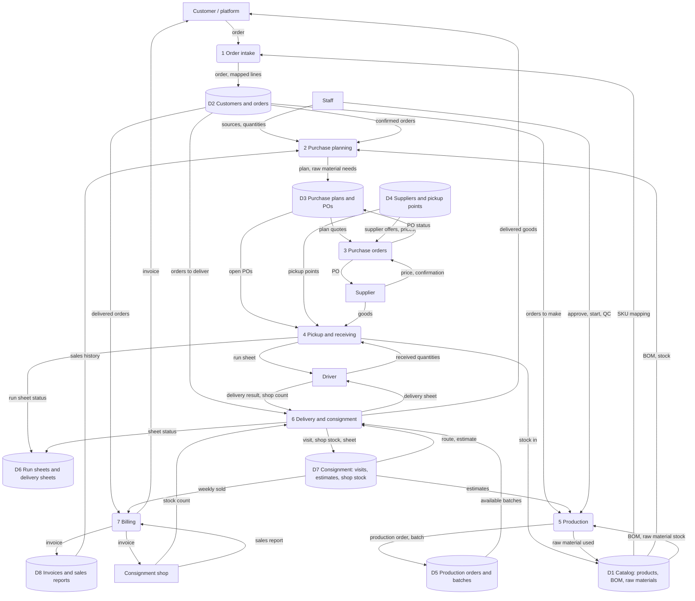
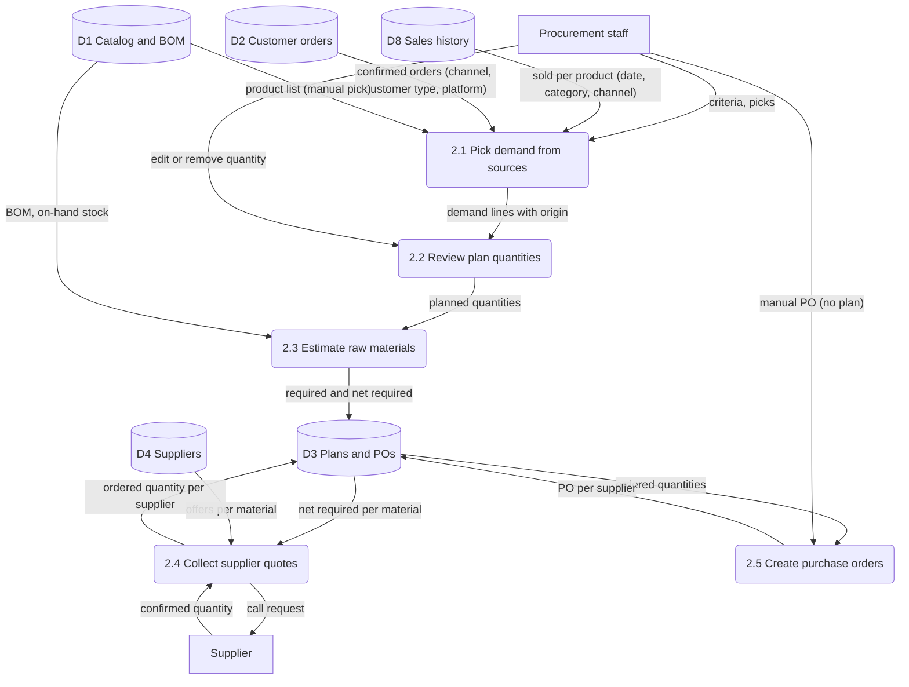
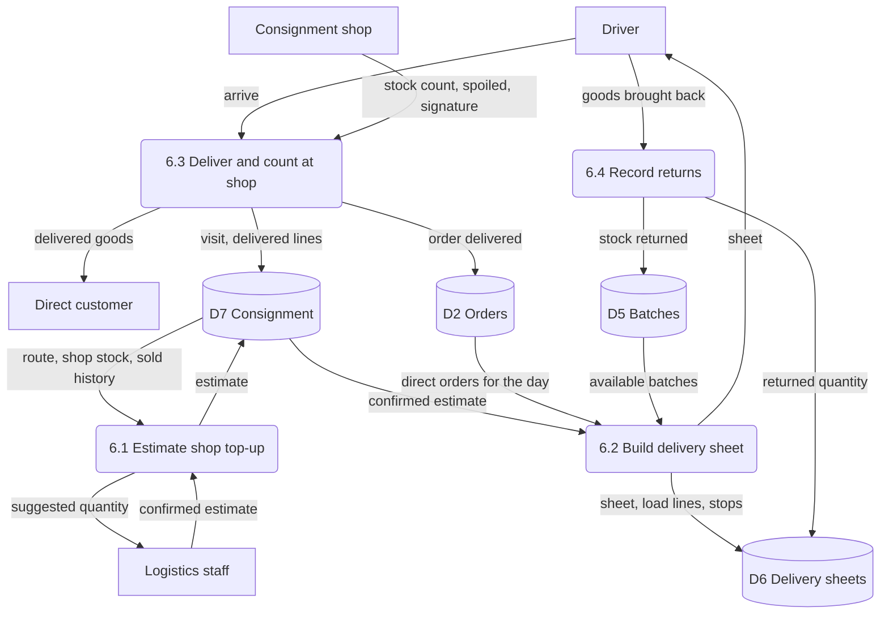
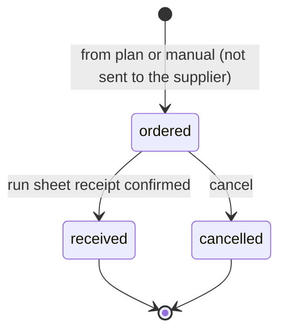
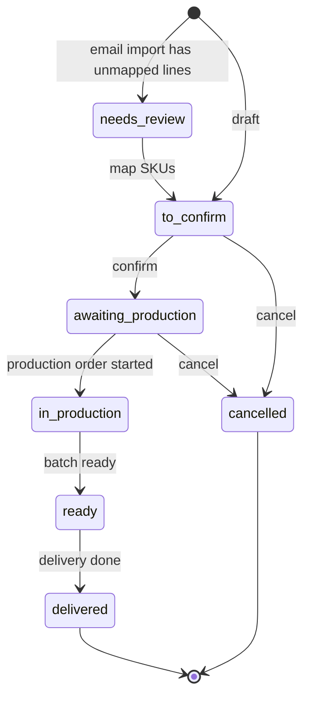
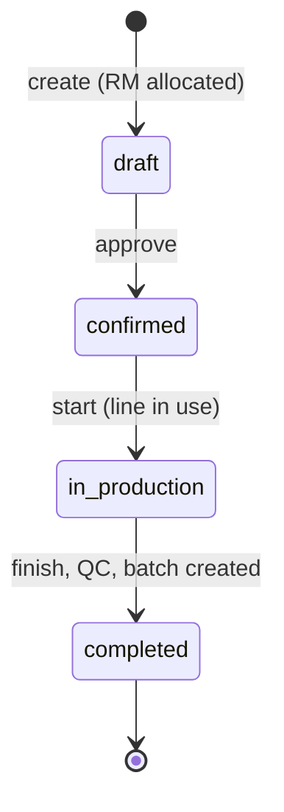
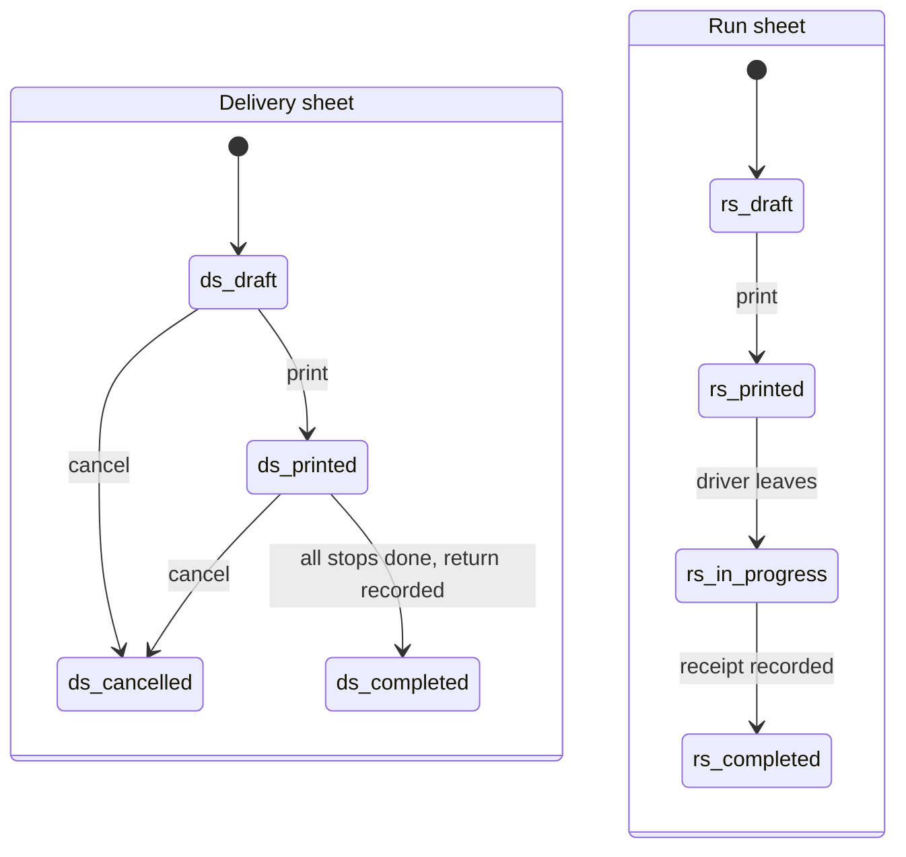
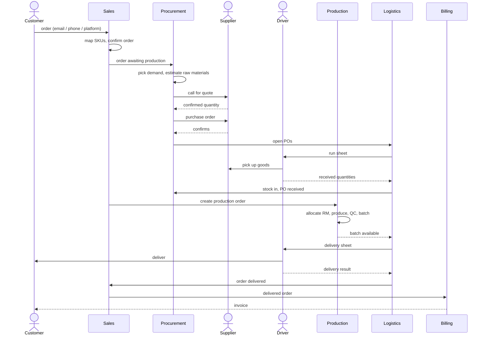

# System diagrams - Bangkok Flower Sale Management

Process view of the system: Data Flow Diagrams (DFD, Gane-Sarson style mapped onto Mermaid) and UML state and sequence diagrams. Derived from `PROCUREMENT_SYSTEM_DESIGN.md` (user flows) and `src/features/*`. Data stores (`D1`…) are groups of tables from `ERD.md`.

Notation in the DFD diagrams: rectangle = external entity, rounded box = process, cylinder = data store, arrow = data flow (labelled with the data).

## 1. DFD level 0 - context diagram

Image: [docs/dfd/1-context.png](docs/dfd/1-context.png)

## 2. DFD level 1 - main processes

Image: [docs/dfd/2-level1.png](docs/dfd/2-level1.png)

## 3. DFD level 2 - purchase planning (process 2)

Image: [docs/dfd/3-level2-planning.png](docs/dfd/3-level2-planning.png)

## 4. DFD level 2 - delivery and consignment (process 6)

Image: [docs/dfd/4-level2-delivery.png](docs/dfd/4-level2-delivery.png)

## 5. UML state machines

### 5.1 Purchase order

Image: [docs/dfd/5-state-po.png](docs/dfd/5-state-po.png) — ⚠ stale (shows the old draft → sent → confirmed lifecycle); regenerate from the diagram below.

### 5.2 Customer order (stage shown in the UI)

Image: [docs/dfd/6-state-order.png](docs/dfd/6-state-order.png)

### 5.3 Production order

Image: [docs/dfd/7-state-production.png](docs/dfd/7-state-production.png)

### 5.4 Delivery sheet and run sheet

Image: [docs/dfd/8-state-sheets.png](docs/dfd/8-state-sheets.png)

## 6. UML sequence - order to cash

Image: [docs/dfd/9-sequence.png](docs/dfd/9-sequence.png)

