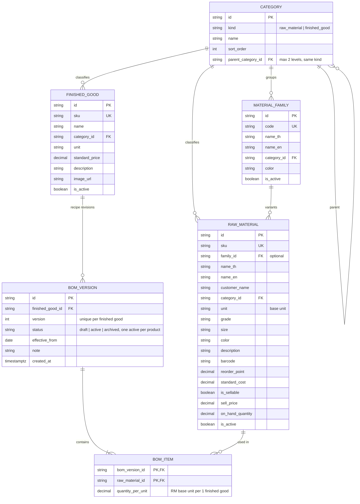
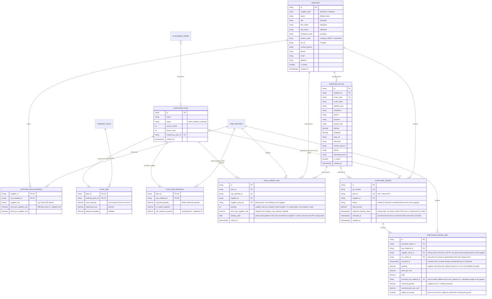
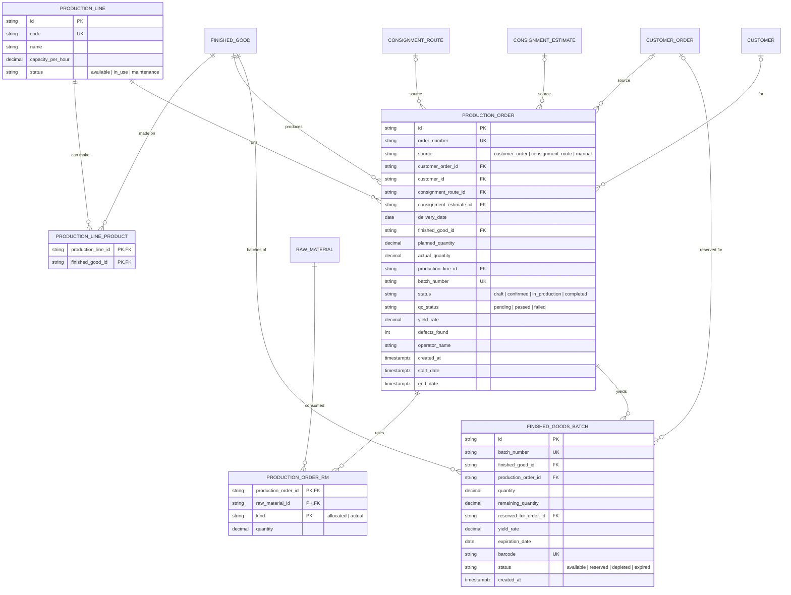
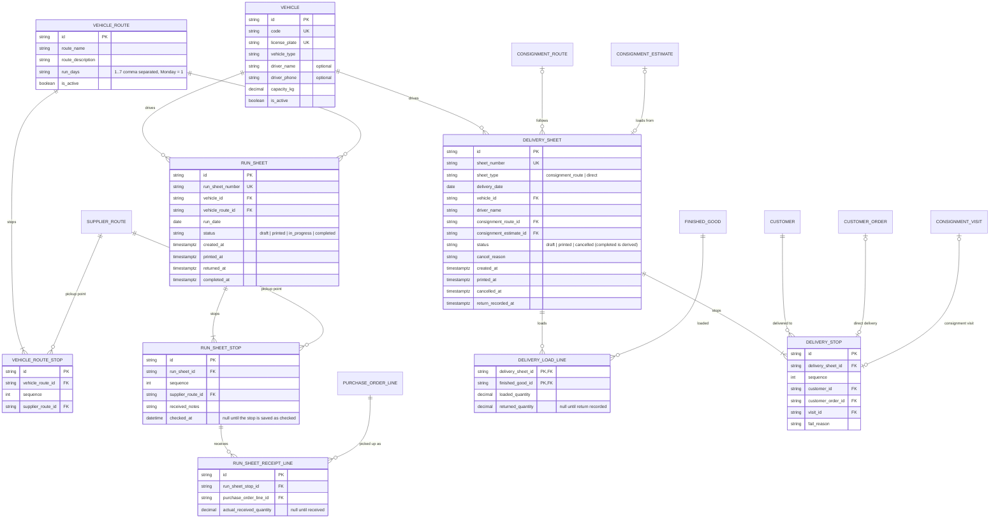
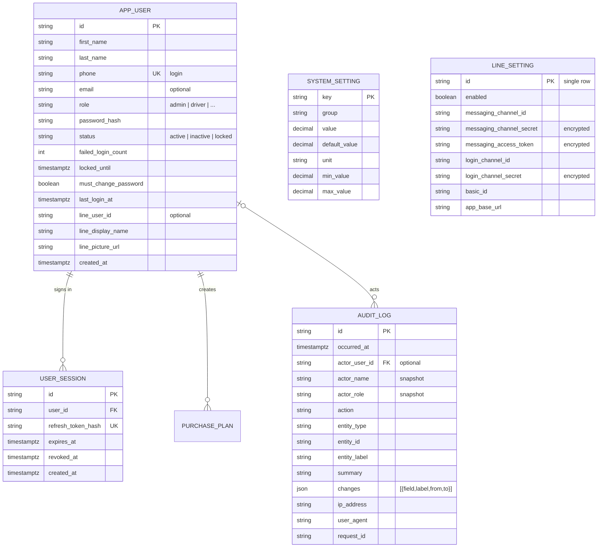

# ERD - Bangkok Flower Sale Management

Entity-relationship diagram of the logical data model. Derived from `src/features/*/types.ts` and `PROCUREMENT_SYSTEM_DESIGN.md`. Arrays nested inside a record in the mock UI (lines, stops, items) are shown as child tables. Diagrams are Mermaid: they render on GitHub and in the VS Code Markdown preview.

Notation: `PK` primary key, `FK` foreign key, `UK` unique. Crow's-foot cardinality: `||` exactly one, `o|` zero or one, `|{` one or more, `o{` zero or more.

## Conventions

- Status columns are enums (values listed in the column comment).
- Money is `decimal`, quantities `decimal`, timestamps `timestamptz`, dates `date`.
- A raw material's current stock (`on_hand_quantity`) and the plan's stock snapshot are separate: the snapshot is frozen when the plan is created.
- Not modelled: the `Property` and `AppNotification` demo entities of the UI template, and derived views (`ConsignmentWeek`, `SalesHistory`, `RmShortage`), which are computed from the tables below.

## 1. Catalog (master data)

Image: [docs/erd/1-catalog.png](docs/erd/1-catalog.png)

## 2. Procurement

Image: [docs/erd/2-procurement.png](docs/erd/2-procurement.png)

A plan order line exists only for what was actually ordered: a raw material left at quantity 0 for a supplier has no row. Saving a supplier replaces all of that supplier's lines in the plan. Progress of a raw material is the sum of `quantity x supplier_raw_material.units_per_supplier_unit` over its lines (ordering more than `net_required_quantity` is allowed). `purchase_order` rows are generated by grouping the lines on `supplier_id` only — **one PO per supplier**; each `purchase_order_line` keeps its own `supplier_route_id` (pickup point).

A PO is created `ordered` and is **not sent** to the supplier (the date was agreed on the phone). The logistics run sheet collects the POs of its route that are due on or before the run date (`purchase_order_line.run_sheet_id`, per pickup point); a PO stays editable and cancellable until a run sheet receipt covering one of its lines is confirmed. Confirming sets `received_at` and fills the `received_*` fields on that sheet's lines, and the PO becomes `received` once all its lines are received (received quantity defaults to the ordered quantity).

Demand sources of a plan (`sales_history`, `customer_orders`, `finished_goods`) are not tables: each plan line keeps its quantity as the sum of picks, and orders pulled in are linked through `customer_order.purchase_plan_id`.

## 3. Sales

Image: [docs/erd/3-sales.png](docs/erd/3-sales.png)

```mermaid
erDiagram
    CUSTOMER ||--o{ CUSTOMER_SKU_MAP : "email import mapping"
    FINISHED_GOOD ||--o{ CUSTOMER_SKU_MAP : maps
    CUSTOMER |o--o{ EMAIL_IMPORT : sends
    EMAIL_IMPORT |o--o| CUSTOMER_ORDER : creates
    CUSTOMER ||--o{ CUSTOMER_ORDER : places
    CUSTOMER_ORDER ||--|{ CUSTOMER_ORDER_LINE : contains
    FINISHED_GOOD |o--o{ CUSTOMER_ORDER_LINE : ordered
    CUSTOMER_ORDER |o--o| INVOICE : "billed by"
    CUSTOMER ||--o{ SHOP_STOCK : "holds (consignment)"
    FINISHED_GOOD ||--o{ SHOP_STOCK : stocked
    FINISHED_GOODS_BATCH ||--o{ SHOP_STOCK : "from batch"
    CUSTOMER ||--o{ CONSIGNMENT_VISIT : visited
    CONSIGNMENT_VISIT ||--o{ CONSIGNMENT_VISIT_LINE : records
    FINISHED_GOOD ||--o{ CONSIGNMENT_VISIT_LINE : counted
    CUSTOMER ||--o{ SALES_REPORT : reports
    SALES_REPORT ||--|{ SALES_REPORT_LINE : contains
    FINISHED_GOOD ||--o{ SALES_REPORT_LINE : sold
    SALES_REPORT |o--o| INVOICE : "billed by"
    CUSTOMER ||--o{ INVOICE : billed
    INVOICE ||--|{ INVOICE_LINE : contains
    FINISHED_GOOD ||--o{ INVOICE_LINE : charged
    CONSIGNMENT_ROUTE ||--|{ CONSIGNMENT_ROUTE_STOP : stops
    CUSTOMER ||--o{ CONSIGNMENT_ROUTE_STOP : "visited on"
    CONSIGNMENT_ROUTE ||--o{ CONSIGNMENT_ESTIMATE : "per delivery date"
    CONSIGNMENT_ESTIMATE ||--|{ CONSIGNMENT_ESTIMATE_LINE : contains
    CUSTOMER ||--o{ CONSIGNMENT_ESTIMATE_LINE : "for shop"
    FINISHED_GOOD ||--o{ CONSIGNMENT_ESTIMATE_LINE : estimated

    CUSTOMER {
        string id PK
        string code UK
        string name
        string name_en
        string type "direct | consignment"
        string chain
        decimal gp_percent "consignment"
        string contact_person
        string phone
        string email
        string address
        string address_en
        string country "export customers"
        boolean is_active
        string import_sender_email "email import profile"
        string import_file_type "xlsx | csv | pdf"
        int import_header_row
        string import_product_column
        string import_quantity_column
        string import_delivery_date_cell
    }
    CUSTOMER_SKU_MAP {
        string customer_id PK, FK
        string customer_sku PK
        string finished_good_id FK
    }
    EMAIL_IMPORT {
        string id PK
        timestamptz received_at
        string from_address
        string subject
        string attachment_name
        string customer_id FK
        string status "parsed | needs_review | failed"
        string order_id FK
        string issues "list of parse issues"
    }
    CUSTOMER_ORDER {
        string id PK
        string order_number UK
        string customer_id FK
        string import_id FK
        timestamptz received_at
        date requested_delivery_date
        string channel "email | phone | platform | manual"
        string platform_name
        string platform_order_ref
        string status "draft | confirmed | delivered | cancelled"
        string purchase_plan_id FK
        string delivery_sheet_id FK
        string invoice_id FK
        timestamptz confirmed_at
        timestamptz delivered_at
    }
    CUSTOMER_ORDER_LINE {
        string id PK
        string order_id FK
        string customer_sku
        string finished_good_id FK "null until mapped"
        decimal quantity
    }
    SHOP_STOCK {
        string customer_id PK, FK
        string batch_number PK
        string finished_good_id FK
        string barcode
        decimal quantity
    }
    CONSIGNMENT_VISIT {
        string id PK
        string visit_number UK
        string customer_id FK
        date visit_date
        string driver_name
        string delivery_sheet_id FK
        string status "draft | signed | cancelled"
        string signed_by
        timestamptz signed_at
    }
    CONSIGNMENT_VISIT_LINE {
        string id PK
        string visit_id FK
        string kind "previous_balance | counted | spoiled | delivered"
        string finished_good_id FK
        string batch_number
        string barcode
        decimal quantity
    }
    SALES_REPORT {
        string id PK
        string report_number UK
        string customer_id FK
        timestamptz received_at
        date period_from
        date period_to
        string status "pending | confirmed | invoiced"
        string note
        string invoice_id FK
    }
    SALES_REPORT_LINE {
        string sales_report_id PK, FK
        string finished_good_id PK, FK
        decimal reported_quantity
        decimal confirmed_quantity
    }
    INVOICE {
        string id PK
        string invoice_number UK
        string customer_id FK
        string source "customer_order | sales_report"
        string source_id "polymorphic, no FK"
        timestamptz issued_at
        date due_date
        string status "issued | paid"
        timestamptz paid_at
    }
    INVOICE_LINE {
        string invoice_id PK, FK
        string finished_good_id PK, FK
        decimal quantity
        decimal unit_price
    }
    CONSIGNMENT_ROUTE {
        string id PK
        string code UK
        string name
        int_array days_of_week "1..7, Monday = 1"
        boolean is_active
    }
    CONSIGNMENT_ROUTE_STOP {
        string id PK
        string route_id FK
        int sequence
        string customer_id FK
    }
    CONSIGNMENT_ESTIMATE {
        string id PK
        string estimate_number UK
        date delivery_date
        string consignment_route_id FK
        string status "draft | confirmed | cancelled"
        timestamptz confirmed_at
    }
    CONSIGNMENT_ESTIMATE_LINE {
        string estimate_id PK, FK
        string customer_id PK, FK
        string finished_good_id PK, FK
        decimal suggested_quantity
        decimal estimated_quantity
    }
```

## 4. Production and finished goods

Image: [docs/erd/4-production.png](docs/erd/4-production.png)

Raw material stock for allocation is `raw_material.on_hand_quantity` minus the `allocated` rows of open production orders.

## 5. Logistics

Image: [docs/erd/5-logistics.png](docs/erd/5-logistics.png)

The mock UI keeps pickup points (`PickupPoint`) and receipt lines in a separate dataset joined by a display-only PO number. In this model a pickup point is a `supplier_route` and a receipt line points at a `purchase_order_line`, which is the target design in the spec (Phase C).

## 6. Users and cross-cutting

Image: [docs/erd/6-users.png](docs/erd/6-users.png)

`audit_log` references any entity by `entity_type` + `entity_id` (no FK), as described in the design document, and is append-only. The table is named `app_user` because `user` is a reserved word in PostgreSQL. `system_setting` and `line_setting` follow API.md sections 17 and 19. User-ownership columns (`created_by_name`, `signed_by`, `operator_name`, `driver_name`) are free text in the mock UI and would become `..._user_id` FKs to `app_user`; only `purchase_plan` is drawn that way above.
